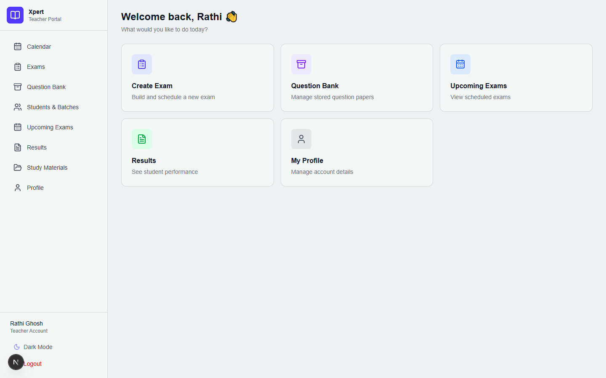
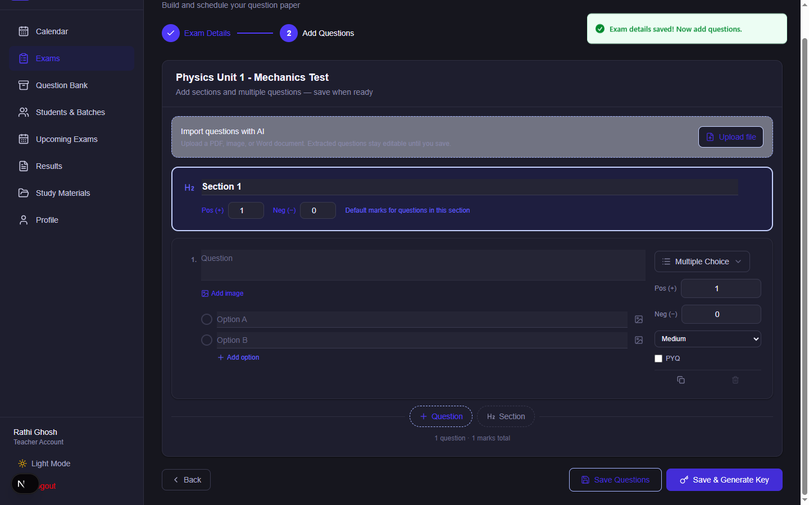
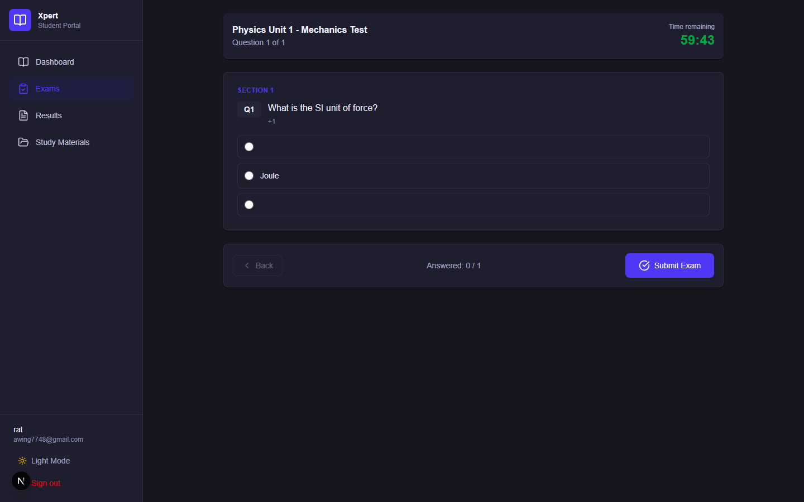
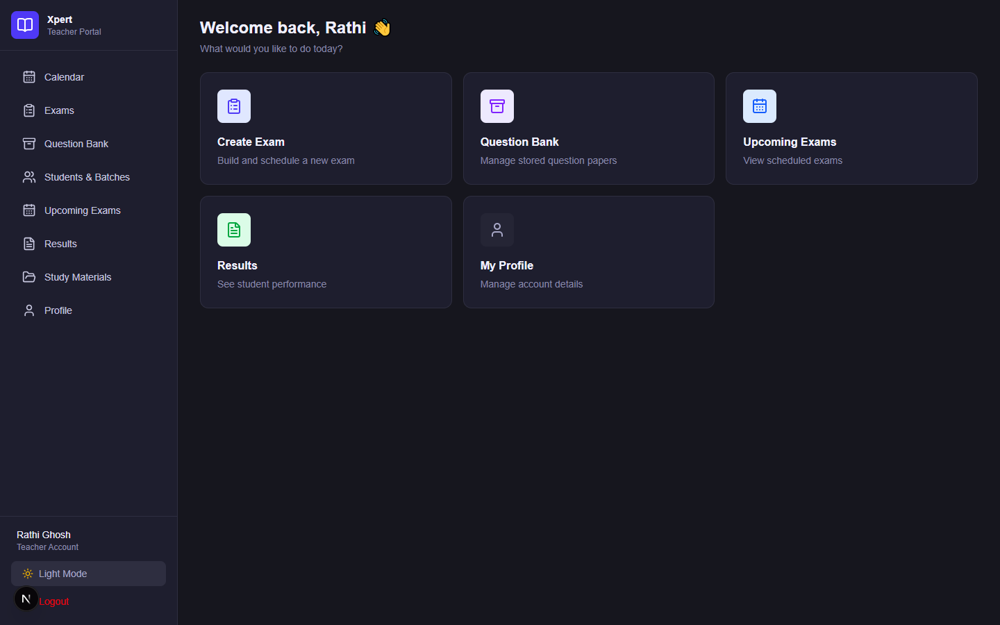
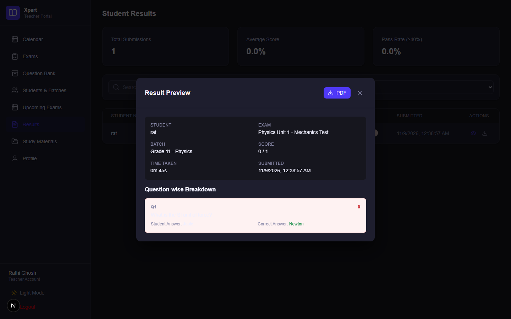
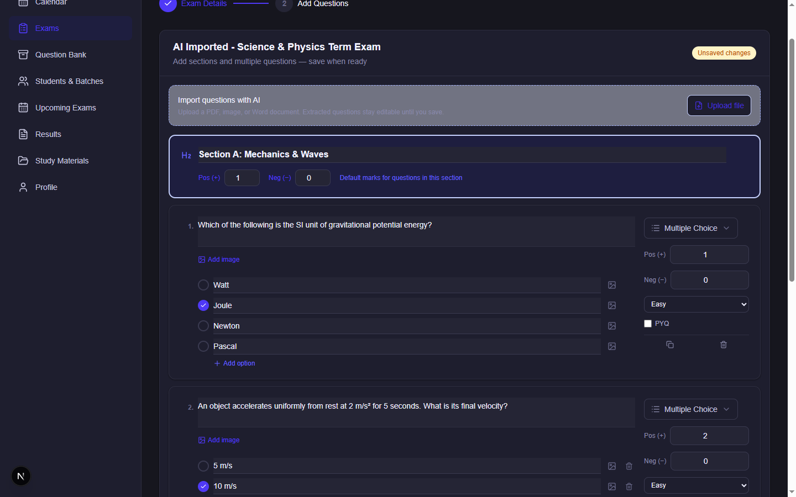

# X-Pert — Online Examination Platform for Independent Teachers

> **A production-ready Next.js + Supabase examination platform built for independent teachers and tutors** who are still managing exams through WhatsApp groups, paper sheets, and manual grading.

`Next.js 16` · `React 19` · `TypeScript` · `Tailwind CSS 4` · `Supabase` · `Zod` · `Gemini AI`

---

## Screenshots

<table>
  <tr>
    <td align="center"><b>Teacher Dashboard</b></td>
    <td align="center"><b>Exam Creator</b></td>
    <td align="center"><b>Student Exam Interface</b></td>
  </tr>
  <tr>
    <td></td>
    <td></td>
    <td></td>
  </tr>
  <tr>
    <td align="center"><b>Dark Mode</b></td>
    <td align="center"><b>Results &amp; Analytics</b></td>
    <td align="center"><b>AI Question Extraction</b></td>
  </tr>
  <tr>
    <td></td>
    <td></td>
    <td></td>
  </tr>
</table>

---

## The Problem

Independent teachers and small coaching centers still run exams the old, painful way:

- 📋 Student batches tracked in messy Google Sheets or Excel files
- 📄 Question papers shared as PDFs through WhatsApp groups
- ✍️ Students submit answers by hand or photo
- ⏱️ Teachers spend hours manually checking papers and compiling scores
- 📊 No timed tests, no negative marking, no integrity controls
- 😰 Parents keep asking for results the teacher has no clean way to share

**Existing tools don't solve this:**

| Existing Options | The Gap |
|---|---|
| Heavy LMS platforms (Moodle, Canvas, Google Classroom) | Built for schools and colleges — far too complex for a solo teacher running 3–5 batches |
| Free / open-source exam tools | Incomplete, poorly documented, or require heavy server administration |

**X-Pert sits exactly in the middle** — a focused, modern examination platform a solo teacher can start using in one afternoon.

---

## Who Is This For?

| You are... | What you get |
|---|---|
| **A developer** | A clean, typed, feature-sliced codebase with real production patterns (services, schemas, contexts, RLS) you can extend instead of rewriting |
| **A founder** | A working examination product you can rebrand, deploy, and build a business around — without starting from zero |
| **An ed-tech builder or agency** | A focused foundation to white-label for coaching centers or extend into a larger education product |

---

## Market Opportunity

Independent tutors and small coaching institutes exist in every country. In India alone — across CBSE, ICSE, JEE, NEET, and state-board coaching — private tutoring is a multi-billion dollar market. These teachers are not looking for another full LMS. They want fast batch creation, easy exam setup, automatic grading, and clean result sharing.

X-Pert targets exactly this high-frequency pain point.

**What this means for a buyer:**
- White-label it and offer it as a SaaS to coaching centers
- Use it as the foundation of a micro-SaaS for teachers (add billing and onboarding)
- Start an ed-tech product from a working codebase instead of a blank repo
- Save weeks of work building batches, exams, grading logic, and results from scratch

---

## Core Features

### 🏫 Batch Management
- Create unlimited student batches with **unique join codes** (e.g. `GRA-HLLF`)
- Students self-enroll using the code — no manual roster management
- Activate / deactivate batches; supports CBSE, ICSE, JEE, NEET, State Board, Aptitude boards

### 📝 Examination System
- **Four question types:** Multiple Choice (MCQ), True/False, Numerical, Theoretical
- **Image support** for both questions and answer options
- **Two-step exam creator:** configure exam settings → build question paper
- **Instant exams** or **scheduled exams** with a defined window
- **Global exam timer** with auto-submit when time expires
- **Per-question timers** (client-side)
- **"No Reverse Back" mode** — students cannot navigate to previous questions
- **Positive and negative marking** configurable per exam
- Exam status lifecycle: `draft → scheduled → active → completed → archived`

### 🤖 AI Question Extraction (Powered by Gemini)
- Upload a **PDF, PNG, JPG, or DOCX** question paper
- Gemini AI parses it and populates a fully editable question paper — with sections, options, correct answers, and marks
- Works from the Question Bank page and directly inside the Exam Creator
- Rate-limited: 5 requests per 10 minutes, 30 per day per user

### 📊 Results & Analytics
- **Automatic grading** of objective questions on submission
- **Question-by-question breakdown** showing the student's answer vs. the correct answer
- Score, percentage, rank in batch, and pass/fail status
- **Teacher analytics dashboard** with total submissions, average score, and pass rate
- **Individual student result preview** panel for teachers
- **PDF result export** for students and teachers

### 📚 Study Materials
- Teachers upload and organize notes, PDFs, images, and links per batch
- Hierarchical folder structure with chapter/topic tagging
- Students access materials directly in their portal

### 🗓️ Additional Teacher Tools
- **Calendar / schedule view** for classes and exams
- **Question bank** — reuse and inspect questions across exams
- **Upcoming exams** overview
- **Profile management**

---

## Feature Comparison

| Feature | Typical Free Tools | X-Pert |
|---|---|---|
| Focused on independent teachers | Rarely | Built specifically for them |
| Modern stack (Next.js 16 + React 19) | Often outdated | Current stack |
| Feature-sliced architecture | Uncommon | Yes |
| Strong TypeScript + Zod types | Weak or missing | Full database and domain types |
| Negative marking + timed questions | Limited | Supported |
| Image questions and options | Uncommon | Supported |
| AI question extraction from documents | Missing | Gemini-powered |
| "No Reverse Back" integrity mode | Rare | Built in |
| PDF result export | Often missing | Included |
| Ready-to-run with clear setup | Often incomplete | Schema + step-by-step guide |
| Commercial white-label potential | License issues | Non-exclusive commercial license |

You are not buying another half-finished GitHub repo. You are buying a focused product foundation that already solves a real problem.

---

## How It Works

**Teacher flow**

```
Sign up → Create a batch → Share the join code → Build an exam (or import with AI) →
Set duration, marking, timers → Run instantly or schedule → Review results → Export PDF
```

**Student flow**

```
Sign up → Join a batch with the code → See available exams → Take the timed exam → View results
```

---

## System Architecture

```mermaid
flowchart TD

subgraph group_identity["Identity and shared services"]
  node_signup["Sign up<br/>[SignupForm.tsx]"]
  node_auth_context["Auth context<br/>[AuthContext.tsx]"]
  node_student_context["Student context<br/>[StudentContext.tsx]"]
  node_auth_service["Auth service<br/>[auth.service.ts]"]
end

subgraph group_teacher["Teacher tools"]
  node_batch_manager["Batch management"]
  node_calendar["Calendar scheduling<br/>[CalendarPage.tsx]"]
  node_exam_creator["Exam creation"]
  node_paper_builder["Paper builder"]
  node_question_bank["Question bank"]
  node_extraction["Question extraction"]
  node_materials_manager["Materials manager"]
  node_teacher_results["Teacher results"]
end

subgraph group_student["Student experience"]
  node_student_join["Batch enrollment"]
  node_student_exams["Available exams"]
  node_exam_session["Timed exam session<br/>[page.tsx]"]
  node_student_results["Student results"]
  node_upcoming_exams["Upcoming exams"]
  node_student_materials["Study materials"]
end

subgraph group_platform["Platform services"]
  node_extraction_api["Extraction API<br/>[route.ts]"]
  node_supabase[("Supabase backend<br/>[supabase-client.ts]")]
  node_storage[("Supabase storage<br/>[storage.service.ts]")]
end

node_teacher_actor(("Teacher"))
node_student_actor(("Student"))
node_gemini["Gemini API"]

node_teacher_actor -->|"signs up"| node_signup
node_signup -->|"submits credentials"| node_auth_service
node_auth_service -->|"authenticates"| node_supabase
node_auth_context -->|"loads profile"| node_auth_service
node_student_actor -->|"joins batch"| node_student_join
node_student_join -->|"calls enrollment RPC"| node_student_context
node_student_context -->|"persists"| node_supabase
node_teacher_actor -->|"creates batches"| node_batch_manager
node_batch_manager -->|"reads and writes"| node_supabase
node_batch_manager -->|"creates sessions"| node_calendar
node_teacher_actor -->|"creates exams"| node_exam_creator
node_exam_creator -->|"builds paper"| node_paper_builder
node_exam_creator -->|"sources questions"| node_question_bank
node_exam_creator -->|"saves exam"| node_supabase
node_teacher_actor -->|"uploads questions"| node_extraction
node_extraction -->|"submits file"| node_extraction_api
node_extraction_api -->|"requests extraction"| node_gemini
node_teacher_actor -->|"manages materials"| node_materials_manager
node_materials_manager -.->|"uploads files"| node_storage
node_teacher_actor -->|"reviews results"| node_teacher_results
node_student_actor -->|"views exams"| node_student_exams
node_student_exams -->|"starts exam"| node_exam_session
node_exam_session -->|"submits answers"| node_student_results
node_student_actor -->|"checks schedule"| node_upcoming_exams
node_student_actor -->|"views materials"| node_student_materials

classDef toneBlue fill:#dbeafe,stroke:#2563eb,stroke-width:1.5px,color:#172554
classDef toneAmber fill:#fef3c7,stroke:#d97706,stroke-width:1.5px,color:#78350f
classDef toneMint fill:#dcfce7,stroke:#16a34a,stroke-width:1.5px,color:#14532d
classDef toneRose fill:#ffe4e6,stroke:#e11d48,stroke-width:1.5px,color:#881337
classDef toneIndigo fill:#e0e7ff,stroke:#4f46e5,stroke-width:1.5px,color:#312e81
classDef toneViolet fill:#f3e8ff,stroke:#7c3aed,stroke-width:1.5px,color:#3b0764
class node_signup,node_auth_context,node_student_context,node_auth_service toneBlue
class node_batch_manager,node_calendar,node_exam_creator,node_paper_builder,node_question_bank,node_extraction,node_materials_manager,node_teacher_results toneAmber
class node_student_join,node_student_exams,node_exam_session,node_student_results,node_upcoming_exams,node_student_materials toneMint
class node_extraction_api,node_supabase,node_storage toneRose
class node_teacher_actor,node_student_actor toneIndigo
class node_gemini toneViolet
```



### Key Architectural Decisions

- **Feature-Sliced Design** — business logic lives in `src/features/`. Each feature has its own components, services, schemas, types, and hooks. Easy to navigate and extend.
- **Strict Separation of Concerns** — UI components hold no business logic. Services talk to Supabase. Zod schemas validate inputs. Types are shared and consistent.
- **Role-Based Access** — Teacher and Student flows are separated at route level and enforced by Supabase Auth + RLS policies.
- **Supabase as the Backend** — Auth, PostgreSQL, and Storage fully managed. A handful of Next.js API routes handle server-side work (AI extraction, etc.).
- **Type Safety End-to-End** — database shapes, API payloads, and form data are all strongly typed.

This architecture is deliberately built so a developer can confidently add new features — parent portal, notifications, AI tools, multi-tenancy — without fighting the codebase.

---

## Tech Stack

| Layer | Technology | Why |
|---|---|---|
| Framework | Next.js 16 (App Router) | Modern, fast, excellent DX |
| UI | React 19 + Tailwind CSS 4 | Latest React with utility-first styling |
| Backend & Auth | Supabase (Auth + PostgreSQL + Storage) | Fast setup, strong RLS model |
| Validation | Zod 4 | Runtime + TypeScript safety |
| AI | Google Gemini API | Question extraction from documents |
| Charts | Recharts | Clean analytics charts |
| PDF | jsPDF + jspdf-autotable | Reliable result export |
| Icons | Lucide React | Consistent, lightweight |
| Language | TypeScript | Full type safety |
| Package Manager | Bun (recommended) / npm / pnpm | Fast installs |

---

## What's Included

- **Teacher Portal** — Dashboard, batch manager, exam creator, question paper builder, AI question extraction, question bank, results & analytics, study materials, calendar, upcoming exams, profile
- **Student Portal** — Batch enrollment via code, exam list, timed exam session, results breakdown, study materials
- **Supabase Backend** — Auth (JWT + roles), PostgreSQL with RLS, Storage for exam images and materials
- **26 ordered SQL migrations** — full schema source of truth in `supabase/migrations/`
- **TypeScript types** — `database.types.ts` matches the full schema
- **Zod validation** — across all forms and API routes
- **Grading engine** — positive and negative marking, auto-grade on submit
- **Exam integrity controls** — no-reverse-back mode, auto-submit on timeout
- **PDF generation** — downloadable result reports
- **Dark mode** — across both teacher and student portals

---

## Project Structure

```
x-pert/
├── app/                              # Next.js App Router
│   ├── teacher/                      # Teacher portal routes
│   │   ├── page.tsx                  # Dashboard
│   │   ├── batches/
│   │   ├── exams/
│   │   ├── bank/
│   │   ├── results/
│   │   ├── materials/
│   │   ├── calendar/
│   │   ├── upcoming/
│   │   └── profile/
│   ├── student/                      # Student portal routes
│   │   ├── page.tsx
│   │   ├── join/
│   │   ├── exams/[examId]/take/
│   │   ├── results/
│   │   └── materials/
│   ├── login/ · signup/ · forgot-password/
│   └── api/                          # Server-side routes (AI extraction, health)
│
├── src/
│   ├── features/                     # Feature modules — core of the architecture
│   │   ├── auth/
│   │   ├── batch-manager/
│   │   ├── calendar-schedule/
│   │   ├── exam-creator/
│   │   ├── exam-list/
│   │   ├── question-bank/
│   │   ├── question-builder/
│   │   ├── question-extraction/
│   │   ├── student-exams/
│   │   ├── student-join/
│   │   ├── student-results/
│   │   ├── study-materials/
│   │   ├── teacher-results/
│   │   └── upcoming-exams/
│   │
│   ├── shared/                       # Shared utilities, types, components
│   │   ├── services/                 # supabase-client.ts, storage.service.ts
│   │   ├── types/                    # database.types.ts, common.types.ts, user.types.ts
│   │   ├── schemas/
│   │   ├── hooks/
│   │   ├── utils/
│   │   └── components/               # UI primitives (Button, Card, Modal, Input…)
│   │
│   └── contexts/
│       ├── AuthContext.tsx
│       └── StudentContext.tsx
│
├── supabase/migrations/              # 26 ordered SQL migration files
├── doc/screenshots/                  # Full UI screenshot catalog
├── package.json
├── tsconfig.json
└── next.config.ts
```

---

## Database Overview

The 26 ordered migrations in `supabase/migrations/` define the complete schema: tables, indexes, RLS policies, views, and RPCs.

### Main Entities

| Table | Purpose |
|---|---|
| `users` / profiles | User accounts with role: `teacher` or `student` |
| `teachers` | Teacher-specific metadata |
| `batches` | Batch groups with join codes |
| `batch_enrollments` | Student ↔ Batch membership |
| `exams` | Exam records with settings and status |
| `questions` | Questions with type, marks, options, images |
| `exam_submissions` | Student submission records |
| `submission_answers` | Per-question student answers |
| `notes` / study materials | Teacher-uploaded resources |
| `calendar_schedules` | Class and exam schedule entries |

Additional tables for attendance, doubts, payment logs, todos, and assignments are included in the schema — available to extend, not part of the documented feature set above.

All TypeScript interfaces matching the database are in `src/shared/types/database.types.ts`.

---

## Quick Start

### 1. Install dependencies

```bash
bun install
# or npm install / pnpm install
```

### 2. Create environment file

Copy `.env.example` to `.env.local` and fill in:

```env
NEXT_PUBLIC_SUPABASE_URL=your_supabase_project_url
NEXT_PUBLIC_SUPABASE_ANON_KEY=your_supabase_anon_key
GEMINI_API_KEY=your_gemini_api_key
```

### 3. Set up Supabase

1. Create a new project at [supabase.com](https://supabase.com)
2. Run the SQL migrations in `supabase/migrations/` in order via the Supabase SQL editor, or use `supabase db reset` locally
3. Create a **public** storage bucket named `exam-images`
4. Review and tighten RLS policies before going live

> **Important:** The hosted database was created from SQL snippets; there is no confirmed CLI migration history. Do not run a blind `supabase db push`. Follow the [deployment safety guide](./docs/deployment.md) first.

### 4. Run development server

```bash
bun run dev
```

Open [http://localhost:3000](http://localhost:3000)

### 5. Production build

```bash
bun run build
bun run start
```

---

## Available Scripts

```bash
bun run dev      # Start development server with hot reload
bun run build    # Create optimized production build
bun run start    # Start the production server
bun run lint     # Run ESLint
bun run test     # Run Vitest tests
```

---

## Buyer-Focused Value

### For Developers
- Clean, modern, feature-sliced codebase — easy to navigate and extend
- Strong TypeScript throughout — no guessing shapes or hunting for types
- Real production patterns: services, schemas, contexts, Supabase RLS
- A solid foundation for adding a parent portal, push notifications, AI tools, or multi-tenancy

### For Founders / Non-Technical Buyers
- A working examination product, not just a code sample
- A clear real-world problem with a clean solution
- White-labelable for coaching institutes
- Ready to grow into a micro-SaaS with monthly subscription plans
- Significantly faster than building from scratch
- Well-documented enough that any developer can take it over quickly

---

## Commercial License

When purchased, you receive a **non-exclusive commercial license**.

You may:
- ✅ Modify the code
- ✅ Rebrand it
- ✅ Deploy it for your own business
- ✅ Sell access to it as a SaaS
- ✅ Use it as the foundation of a larger education product
- ✅ Keep all rights to your modifications

---

## What Is Not Included (Sold As-Is)

To keep expectations clear, the following are **not** included:

- Live proctoring / webcam monitoring
- Parent portal
- Offline exam recovery after disconnection
- Email or push notifications
- Subscription billing and payment processing
- Multi-tenancy / organization-level features
- Production deployment, custom domain, or hosting setup
- Ongoing support, bug fixes, or updates from the original author

X-Pert is delivered as a complete, working foundation. All further development is in your hands.

---

## Recommended First Steps After Purchase

1. Run the SQL migrations on a fresh Supabase project
2. Deploy the Next.js app to Vercel (the simplest path)
3. Create a teacher account and one test batch
4. Create a sample exam with different question types
5. Take the exam as a student and verify results + PDF
6. Review RLS policies, auth redirect URLs, and environment variables before inviting real users
7. Choose your business model:
   - White-label for coaching centers
   - Micro-SaaS with monthly plans
   - Internal tool for your own teaching business
8. Add branding, a custom domain, and payment integration

---

## Technical Notes for Developers

- All database interactions go through the **service layer** inside each feature — not in React components.
- Zod schemas are used for all form and API validation.
- `database.types.ts` is the single source of truth for entity shapes.
- The `exam-images` Supabase storage bucket holds question and option images.
- Adding a new feature should follow the same pattern:
  `features/your-feature/{components, services, schemas, types, hooks}`
- Per-question timers run on the client only — they are not enforced or persisted server-side.
- Exam keys and PINs are hidden from student views but are not enforced as an access gate.
- AI extraction is rate-limited: 5 requests per 10 minutes, 30 per day per user, on a single server instance.

---

## Upcoming — Version 2.0

> **For contributors and future builders:** This section is a detailed task reference — not marketing copy. Every item below is a real feature with enough specification to pick it up and start building. Items are grouped by platform and priority. The database schema is already ahead of the UI for many of these features; those are marked ✅ Schema ready.

---

### 🏫 Phase 2 — Production-Level Classroom Management (Web)

All schema is already written. These features need UI pages and service layers built in `src/features/` following the existing feature-sliced pattern.

---

#### 1. Attendance Tracking

**Schema:** `supabase/migrations/13_attendance.sql`  
**Tables:** `attendance_records` (batch_id, student_id, date, status: `present|absent`, marked_by)  
**Route to create:** `/teacher/attendance`

**What to build:**
- Teacher opens Attendance page, selects a batch and a date (defaults to today)
- A roster of enrolled students loads from `batch_enrollments`
- Teacher taps Present / Absent toggle per student — one row per student per date
- Save button upserts into `attendance_records` using the `unique_student_batch_date` constraint
- History view: a monthly calendar heat-map or table showing per-student attendance %
- Student view at `/student/attendance` — read-only list of their own attendance records per batch
- Filter by batch, date range, and status (all / absent only)
- Export: CSV or PDF monthly attendance sheet per batch

**Edge cases to handle:**
- Duplicate submission guard (constraint already in schema)
- Teacher can edit a past date's record (re-mark)
- Show attendance % badge on batch card in `/teacher/batches`

---

#### 2. Fee & Payment Tracking

**Schema:** `supabase/migrations/17_payment_logs.sql`  
**Tables:** `payment_logs` (batch_id, student_id, month `YYYY-MM`, is_paid, marked_by, marked_at)  
**Teacher schema:** `teachers.upi_id`, `teachers.upi_qr_url`  
**Route to create:** `/teacher/fees`

**What to build:**
- Fee dashboard: select batch → see a grid of students × months
- Each cell is a toggle — green (paid) / red (unpaid); clicking marks/unmarks payment
- Marks go into `payment_logs` via upsert on `unique_batch_student_month`
- Summary row at bottom: total collected vs. total expected per month
- Teacher profile page: add UPI ID and UPI QR image upload (store QR in Supabase Storage)
- Student view: `/student/fees` — read-only fee status per batch per month
- Export: monthly PDF or CSV fee collection report

**Edge cases:**
- Month selector defaults to current month
- Handle months with no rows yet (insert fresh on first toggle)
- Show overdue (unpaid for past months) in red highlight

---

#### 3. Assignments

**Schema:** `supabase/migrations/12_assignments.sql`  
**Tables:** `assignments` (batch_id, teacher_id, title, description, deadline, max_marks), `assignment_submissions` (assignment_id, student_id, file_url, file_name, submitted_at, is_late, score, feedback, graded_at)  
**Route to create:** `/teacher/assignments`, `/student/assignments`

**What to build — Teacher:**
- Assignment list page per batch with Create button
- Create modal: title, description (rich text or plain), deadline datetime picker, max marks
- Submission inbox: list all student submissions for a given assignment
- Grading panel: open submission file preview (PDF/image), enter score (0–max_marks), type feedback text, click Grade
- Late submission badge — `is_late` is set automatically if `submitted_at > deadline`
- Status badges per student: Not Submitted / Submitted / Graded

**What to build — Student:**
- Assignment list showing all assignments across enrolled batches
- Deadline countdown badge (e.g. "Due in 2 days")
- File upload: PDF, image, DOCX — stored in Supabase Storage under `assignments/` bucket
- After submission: read-only view of score and feedback once teacher grades

**Edge cases:**
- Prevent re-submission after grading (or allow re-submission with teacher setting)
- File size limit validation (suggest 10 MB)
- `is_late` flag: set server-side in RPC, not client

---

#### 4. Doubts & Q&A Threads

**Schema:** `supabase/migrations/16_doubts.sql`  
**Tables:** `doubts` (batch_id, student_id, title, body, chapter_tag, is_resolved), `doubt_replies` (doubt_id, author_id, body)  
**Route to create:** `/teacher/doubts`, `/student/doubts`

**What to build — Student:**
- Doubt list: all their doubts with status badge (Open / Resolved)
- Raise doubt: form with title, body (textarea), optional chapter tag (matches batch subject tags)
- Thread view: see teacher replies in a chat-like thread

**What to build — Teacher:**
- Inbox of all open doubts across all batches, sorted by newest
- Filter by batch and chapter tag
- Reply form inline — teacher types reply, submits → creates row in `doubt_replies`
- Mark as Resolved button — sets `is_resolved = true` on the doubt
- Badge counter on sidebar nav showing unresolved doubt count

**Edge cases:**
- Real-time updates on new replies using `useSupabaseRealtime` (hook already exists in `src/shared/hooks/`)
- Multiple replies per doubt (thread model, not single reply)
- Student gets notified (initially just a badge; push notification in V3)

---

#### 5. Class Recordings

**Schema:** `supabase/migrations/15_recordings_sql.sql`  
**Tables:** `recordings` (batch_id, teacher_id, title, chapter_tag, video_url, recorded_on)  
**Route to create:** `/teacher/recordings`, `/student/recordings`

**What to build:**
- Teacher: paste a YouTube / Google Drive / Loom video URL and assign it to a batch + chapter tag + date
- Recordings list page: grouped by chapter tag, sortable by date
- Student view: same list (read-only), filtered to their enrolled batch
- Embed preview using an iframe or link-out card (YouTube embed for YT links)
- Search by title or chapter tag

**Edge cases:**
- Validate that `video_url` is a recognizable embeddable URL (YouTube, Drive, Loom)
- Fallback to plain link if URL is unrecognized

---

#### 6. To-Do & Task List

**Schema:** `supabase/migrations/18_todo_items.sql`  
**Tables:** `todo_items` (created_by, batch_id nullable, title, due_date, priority: `high|medium|low`, is_done, is_batch_wide)  
**Route to create:** `/teacher/todos` (or as a sidebar widget on the dashboard)

**What to build:**
- Personal to-do list for the teacher — private tasks not tied to any batch
- Batch-wide tasks — `is_batch_wide = true` — visible to all students in that batch
- Priority badge (High / Medium / Low) with color coding
- Due date with overdue highlight
- Quick-add from the dashboard: title field + due date inline
- Checkbox to mark done — strikethrough animation
- Filter: All / Today / Overdue / Done

---

#### 7. Parent Portal

**Schema:** `supabase/migrations/01_users.sql` — `role` enum already includes `parent`  
**New routes to create:** `/parent/*`

**What to build:**
- Parent signup flow: create account with role `parent`, link to one or more student accounts (via student's email or a link code)
- Parent dashboard: summary cards — child's upcoming exams, last result, attendance %, fee status
- Results tab: read-only view of child's exam results and breakdowns
- Attendance tab: monthly attendance chart per batch
- Fees tab: per-month paid/unpaid status
- Study materials: same read-only view the student sees

**Schema additions needed:**
- `parent_student_links` table: `parent_id → student_id` (many-to-many)
- RLS policies: parent can only read data for linked students

---

#### 8. Subscription & Plan Enforcement

**Schema:** `teachers.plan` (`free|pro`), `teachers.plan_expires_at`, `teachers.upi_id`  
**Route to create:** `/teacher/billing`

**What to build:**
- Billing page showing current plan, expiry date, and upgrade CTA
- Free plan limits (define limits — e.g. max 2 batches, max 3 exams, no AI extraction)
- Plan check middleware in service layer — throw a `PlanLimitError` if limit exceeded
- Paywall modal: show when teacher hits a limit — links to billing page
- Razorpay integration (India-first): create order → verify payment → update `plan` and `plan_expires_at` via a secure RPC
- Stripe as an alternative for international buyers
- Webhook handler: `/api/billing/webhook` — listen for payment confirmation and update plan in Supabase

---

### 📱 Phase 3 — React Native Mobile App

**Technology:** React Native + Expo (managed workflow)  
**Shared backend:** Same Supabase project — same tables, same RPCs, same RLS  
**Shared types:** Copy or publish `src/shared/types/database.types.ts` as an npm package or git submodule

> **Why React Native over PWA:** Native push notifications, offline SQLite storage, camera access for image uploads, and a proper app store presence.

---

#### Student App — Full Feature List

**Auth**
- Login and signup screens matching the web flow
- Supabase Auth via `@supabase/supabase-js` with Expo SecureStore for token persistence
- Biometric login (Face ID / fingerprint) using `expo-local-authentication`

**Batch Management**
- Dashboard showing enrolled batches with teacher name and subject
- Join batch via code — scan QR code (teacher shows QR of join code) or type manually using `expo-barcode-scanner`
- Batch status indicator (active / inactive)

**Exam Taking — Full Offline-Capable Flow**
- Exam list: Upcoming / Ready / Completed tabs with status badges
- **Offline exam cache:** When a student opens an exam while online, questions are cached to device SQLite (`expo-sqlite`) so the exam can continue if connectivity drops
- Exam session screen:
  - Full-screen lock (disable status bar, prevent screenshot via `expo-screen-capture`)
  - Countdown timer using device clock (not network — guards against time manipulation by comparing with `server_time()` RPC at session start and submit)
  - Question cards with MCQ radio selects, True/False toggles, Numerical keyboard input, Theoretical text area
  - Per-question timer bar (visual only — matches web behavior)
  - "No Reverse Back" mode — back button disabled / navigates to submit confirmation
  - Tab switch / app background detection using `AppState` from React Native — calls `record_tab_switch` RPC
  - Auto-submit when countdown reaches zero — submits saved answers via `save_exam_answers` RPC then calls submit RPC
  - **Offline submit queue:** If connectivity is lost at submit time, submission is queued in SQLite and retried automatically when connection is restored (using `NetInfo` from `@react-native-community/netinfo`)
- Results: score card immediately after submit; full breakdown view with correct/wrong per question
- PDF result download via `expo-print` and `expo-sharing`

**Study Materials**
- Browse batch folders and files
- Open PDFs inline via `expo-document-picker` and a PDF viewer (`react-native-pdf`)
- Download and cache files locally for offline reading

**Doubts**
- Raise a doubt with title, body, and chapter tag
- View thread of replies from teacher
- Real-time updates using Supabase Realtime subscription

**Notifications**
- Push notifications via `expo-notifications` + Supabase Edge Function trigger
- Notify on: new exam available, exam starting in 30 minutes, result published, doubt answered, new study material uploaded
- Local notification for exam timer warning (10 minutes remaining)

**Offline Handling — Detailed**
- `NetInfo` monitors connectivity at all times
- When offline: show a banner "You are offline — exam progress is being saved locally"
- Exam answers save to SQLite on every question answer (not just on Next tap)
- On reconnect: auto-sync queued answers and submission to Supabase
- Study material files previously downloaded remain accessible
- Exam list cached from last fetch — shows last-known state with "Last updated X mins ago" label

---

#### Teacher App — Full Feature List

**Auth**
- Login / signup same as student; role detected and routed to teacher home

**Dashboard**
- Quick stat cards: total students, active batches, exams this week, unresolved doubts
- Quick actions: Create Exam, Mark Attendance, View Results

**Batch Management**
- Create batch — name, subject, board, class days, time
- Share join code as text or as a generated QR image (via `expo-sharing`)
- Student roster per batch — tap a student to see their profile, results, attendance, fees

**Exam Management**
- Exam list with status badges and action menu (Edit, Archive, Delete, View Results)
- Exam creator — simplified mobile-optimized version:
  - Step 1: Title, subject, batch, duration, instant or scheduled
  - Step 2: Add questions — MCQ, T/F, Numerical one at a time (full builder is complex for mobile; focus on add/edit/reorder)
  - AI extraction: pick a file from device via `expo-document-picker` → upload to extraction API → questions populate automatically
- Results dashboard: exam selector → list of student submissions → tap for breakdown
- PDF export per student via `expo-print`

**Attendance**
- Select batch + date (defaults to today)
- Student roster with toggle (Present / Absent) — big touch-friendly buttons
- Save and optionally share attendance summary via WhatsApp / email using `expo-sharing`
- History: scroll back through past dates

**Fee Tracking**
- Batch fee grid — student rows × month columns
- Tap a cell to toggle paid/unpaid
- Monthly summary: X of Y students paid

**Assignments**
- Create assignment with title, description, deadline, max marks
- View submission inbox per assignment
- Open submitted file, enter score and feedback, tap Grade

**Doubts Inbox**
- List of all open doubts across batches sorted by newest
- Tap to open thread, type reply, send
- Mark as Resolved with one tap
- Unresolved count badge on tab icon

**Study Materials**
- Create folders, upload files from device via `expo-document-picker`
- Assign to batch and chapter tag

**To-Do List**
- Personal task list with priority and due date
- Quick-add from dashboard widget

**Offline Handling — Teacher App**
- Attendance can be marked offline; records queue in SQLite and sync on reconnect
- Exam creation drafts save locally if connectivity drops mid-creation
- Results and student data cached for the last-fetched state

---

### 🖥️ Phase 4 — Tauri Desktop App (Windows / macOS / Linux)

**Technology:** Tauri v2 (Rust shell) + the existing Next.js frontend  
**Target users:** Teachers who work at a desk and want a proper installable app  
**Distribution:** `.exe` installer (Windows), `.dmg` (macOS), `.AppImage` / `.deb` (Linux)

**Why Tauri over Electron:**
- Binary size ~5 MB vs Electron's ~150 MB
- Uses the OS webview (WebKit on macOS/Linux, WebView2 on Windows) — no bundled Chromium
- Rust backend gives access to native file system, system tray, auto-updater

---

#### Teacher Desktop App — Feature List

**Core Web Features**
- Full teacher portal embedded — all existing web features work as-is in the Tauri webview
- No separate codebase; Tauri wraps the Next.js build output

**Offline Question Paper Authoring**
- When offline, the exam creator saves the in-progress paper to a local JSON file on disk (via Tauri's `fs` plugin)
- On reconnect, a "Sync pending exams" prompt appears — teacher reviews and publishes
- Local draft list: "My Drafts" section in the exam creator sidebar

**Offline PDF Generation**
- Results PDF export works fully offline — jsPDF runs in the browser context, no server needed
- Teacher can export results for the last-synced batch data even without internet

**File System Integration**
- Native file picker dialog (via Tauri `dialog` plugin) for uploading question paper documents, study materials, and recordings
- Drag-and-drop files directly into the app from File Explorer / Finder
- Save result PDFs directly to a chosen folder (not just browser download)

**System Tray**
- App minimizes to system tray (stays running in background)
- Tray icon shows unresolved doubt count badge
- Tray menu: Open App, View Doubts, Quit

**Auto-Updater**
- Tauri's built-in updater checks GitHub Releases (or a custom update server)
- Background download with a "Update ready — restart to apply" notification

**Native Notifications**
- OS-level desktop notifications for new student submissions, doubt replies, and exam completion alerts (via Tauri `notification` plugin)

**Keyboard Shortcuts**
- `Ctrl+N` / `Cmd+N` — New exam
- `Ctrl+K` / `Cmd+K` — Command palette (jump to any page)
- `Escape` — Close any modal

**Offline Handling — Desktop**
- IndexedDB (in the webview) caches the last-fetched state of all teacher data
- A persistent "Offline" banner appears at top when network is not available
- Writes (new exam, attendance mark, grading) queue locally and display a "Pending sync" indicator
- On reconnect, queued operations replay in order with conflict detection

---

### 🔔 Phase 3 — Notifications System

**Trigger layer:** Supabase Edge Functions (Deno) or PostgreSQL triggers calling an edge function

| Notification Event | Channel | Recipient |
|---|---|---|
| New exam published for a batch | Push (mobile), Email | All enrolled students |
| Exam starting in 30 minutes | Push (mobile), Local (desktop) | Enrolled students |
| Student submits exam | Push (mobile), Desktop notification | Teacher |
| Result published | Push (mobile), Email | Student |
| New study material uploaded | Push (mobile) | Enrolled students |
| Doubt raised | Push (mobile), Desktop | Teacher |
| Teacher replies to doubt | Push (mobile) | Student |
| Assignment deadline in 24 hours | Push (mobile) | Students who haven't submitted |
| Fee marked paid | Push (mobile) | Student |

**Implementation notes:**
- Mobile push: Expo Push Notification Service → `expo-notifications` on device
- Email: Supabase Auth emails (already configured) + Resend or SendGrid for custom templates
- Desktop: Tauri `notification` plugin
- Edge Function trigger: insert into `notification_logs` table → fan-out to relevant channels

---

### 🤖 Phase 3 — AI Expansion

**Current:** Gemini extracts questions from an uploaded document  
**Next steps:**

| Feature | Description | Implementation |
|---|---|---|
| **AI question generation** | Teacher provides topic + subject + difficulty → Gemini generates N questions in the structured format | New `/api/questions/generate` route; same parser as extraction |
| **Auto-difficulty tagging** | After extraction, Gemini rates each question Easy / Medium / Hard / PYQ based on content | Post-processing step in existing extraction route |
| **Answer explanation generation** | For each correct answer, Gemini writes a 2–3 line explanation shown to students after exam submission | Stored in a new `question_explanations` table |
| **Paper quality check** | Before publishing, AI reviews the paper for duplicate questions, unbalanced difficulty, and missing mark allocation | Pre-publish modal with AI suggestions |
| **Chapter auto-tag** | Gemini detects the chapter / topic from question text and sets `chapter_tag` automatically | Optional post-extraction step |

---

### 🏢 Phase 4 — Multi-Tenancy / Institute Mode

**Use case:** A coaching institute with 10 teachers sharing a question bank and an admin who sees all analytics

**Schema additions needed:**
- `institutes` table: `id, name, slug, logo_url, plan, created_at`
- `institute_members` table: `institute_id, user_id, role (admin|teacher)`
- `batches.institute_id` FK
- `questions.institute_id` FK for shared question pools

**What to build:**
- Institute admin portal: manage teachers, view cross-teacher analytics, shared question bank
- Teacher sees their own batches plus shared institute resources
- White-label: each institute gets a custom subdomain (`yourcoaching.xpert.app`)
- Institute-level billing: one subscription covers all teachers in the institute

---

### 📋 Contributor Quick Reference

| Item | Location | Status |
|---|---|---|
| Attendance UI | `src/features/attendance/` (create) | Schema ready, UI missing |
| Fee tracking UI | `src/features/fee-tracker/` (create) | Schema ready, UI missing |
| Assignments UI | `src/features/assignments/` (create) | Schema ready, UI missing |
| Doubts UI | `src/features/doubts/` (create) | Schema ready, UI missing |
| Recordings UI | `src/features/recordings/` (create) | Schema ready, UI missing |
| To-do UI | `src/features/todos/` (create) | Schema ready, UI missing |
| Parent portal | `app/parent/` (create) + new schema | Needs `parent_student_links` table |
| Billing page | `app/teacher/billing/` + `/api/billing/webhook` | Needs Razorpay/Stripe integration |
| React Native app | Separate repo `xpert-mobile` | Not started |
| Tauri desktop app | Separate repo `xpert-desktop` | Not started |
| Notification edge function | `supabase/functions/notify/` | Not started |
| AI generation endpoint | `app/api/questions/generate/route.ts` | Not started |

---

## License

The original open-source version is MIT.

When purchased through the marketplace, you receive a **non-exclusive commercial license** allowing you to use, modify, rebrand, and commercially deploy the software.

---

**Built for independent teachers who deserve better tools than spreadsheets and WhatsApp.**
