# X-Pert — Online Examination Platform for Independent Teachers

**A complete Next.js + Supabase examination platform built for independent teachers and tutors** who are tired of spreadsheets, WhatsApp groups, and manual grading.

Create batches, build exams, run timed tests with integrity controls, auto-grade objective questions, and share detailed results — all from one clean, focused web application.

No bloated LMS.  
No institute complexity.  
Just the tools a hardworking independent teacher actually needs.

`Next.js 16` · `React 19` · `TypeScript` · `Tailwind CSS 4` · `Supabase` · `Zod`

<!-- Tip: add 3–5 screenshots or a short demo GIF here (teacher dashboard, exam builder, student exam screen, results). -->

---

## At a Glance

- **Batches with join codes** — students enroll themselves with a unique code
- **Four question types** — MCQ, True/False, Numerical, Theoretical — with image support for questions and options
- **Real exam controls** — global duration, per-question timers, "No Reverse Back" mode, auto-submit when time expires
- **Positive and negative marking** with automatic grading of objective questions
- **Results that teachers can use** — question-by-question breakdown, percentage, rank in batch, PDF export
- **Teacher toolkit** — question bank, question paper builder, question extraction upload, study materials, calendar, upcoming exams
- **Developer-friendly codebase** — feature-sliced architecture, TypeScript, Zod validation, ordered Supabase migrations

### Who Is This For?

| You are... | What you get |
|---|---|
| **A developer** | A clean, typed, feature-sliced codebase with real production patterns (services, schemas, contexts, RLS) that you can extend instead of rewriting |
| **A founder** | A working examination product you can rebrand, deploy, and build a business around — without starting from zero |
| **An ed-tech builder or agency** | A focused foundation to white-label for coaching centers or extend into a larger education product |

---

## The Real Problem

Independent teachers and small coaching centers still run their examinations the painful, manual way:

- Student batches tracked in messy Google Sheets or Excel files
- Question papers shared as PDFs or Word documents through WhatsApp groups
- Students take exams on paper or by submitting photos
- Teachers spend hours manually checking answers and compiling results
- No proper timed tests, no negative marking, no integrity controls
- Parents keep asking for results and the teacher has no clean way to share them

Existing solutions fall into two extremes:

1. **Heavy LMS platforms** (Moodle, Canvas, Google Classroom, etc.)  
   Too complex, too many features, often expensive, and designed for schools and colleges — not for a single teacher running 3–5 batches.

2. **Free / open-source exam tools**  
   Often incomplete, thinly documented, or demanding heavy technical knowledge to set up and maintain.

**X-Pert sits exactly in the middle** — a focused, modern examination platform that a solo teacher can start using in one afternoon.

---

## Real Market Value

Independent teachers, tutors, and small coaching centers exist in every country, and a large share of them still manage exams manually. In India alone (CBSE, ICSE, JEE, NEET, and state-board coaching), private tutoring is a huge market.

These teachers are not looking for another full LMS. They want:

- Fast batch creation with join codes
- Easy exam creation with multiple question types
- Timed tests with integrity controls
- Automatic grading of objective questions
- Clean result sharing

X-Pert targets exactly this high-frequency pain point.

**For buyers on Zero to Hundred**, this means:

- White-label it and offer it to coaching centers
- Use it as the foundation of a micro-SaaS for teachers (add billing and onboarding)
- Start an education product from a working codebase instead of a blank repo
- Save the weeks of work it takes to build batches, exams, grading, and results from scratch

---

## How It Works

**Teacher flow**

1. Sign up and create a batch — share the join code with students
2. Build an exam with the question paper builder, or pull questions from the question bank
3. Set duration, marking scheme, timers, and integrity options; run it instantly or schedule it
4. Review results and analytics, and export PDF results

**Student flow**

1. Sign up and join a batch with the code
2. See available and upcoming exams
3. Take the timed exam
4. View a detailed result breakdown

---

## What's Included

- **Teacher Portal**  
  Dashboard, batch management, exam creator, question paper builder, question bank, question extraction, results analytics, study materials, calendar/schedule, upcoming exams, profile

- **Student Portal**  
  Join a batch via unique code, view exams, take timed exams, view detailed results and breakdowns, upcoming exams, study materials

- **Supabase Backend**  
  Authentication, PostgreSQL database, Storage for images, with access controlled through row level security and database RPCs

- **Database migrations** — ordered SQL files in `supabase/migrations/`, plus matching TypeScript types
- **Full TypeScript + Zod validation** across forms and API inputs
- **Grading engine** supporting positive and negative marking
- **Exam controls** — per-question timers, "No Reverse Back" mode, automatic submission
- **Image support** for questions and options
- **PDF result generation**
- **Clean feature-sliced architecture** that is easy to extend

---

## Why This Is Better Than Free Alternatives

| Feature / Aspect                     | Typical Free Tools     | X-Pert                                  |
|--------------------------------------|------------------------|----------------------------------------|
| Focused on independent teachers      | Rarely                 | Built specifically for them            |
| Modern stack (Next.js 16 + React 19) | Often older            | Current stack                          |
| Feature-sliced architecture          | Uncommon               | Yes                                    |
| Strong TypeScript types              | Weak or none           | Full database + domain types           |
| Negative marking + timed questions   | Limited                | Supported                              |
| Image questions + options            | Uncommon               | Supported                              |
| "No Reverse Back" integrity mode     | Rare                   | Built in                               |
| PDF result export                    | Often missing          | Included                               |
| Ready-to-run with clear setup        | Often incomplete       | Schema + step-by-step instructions     |
| Commercial white-label potential     | License issues         | Non-exclusive commercial license       |

You are not buying another half-finished GitHub repo. You are buying a focused product foundation that already solves a real problem.

---

## System Architecture

The diagram below was generated from the actual codebase and shows how the teacher and student experiences connect to the shared services. File names in brackets point to the real implementation. Solid arrows are core flows; dashed arrows are secondary integrations.

```mermaid
flowchart TD
subgraph group_web["Teacher Web"]
  node_teacher["Teacher portal<br/>[page.tsx]"]
  node_batches["Batch management"]
  node_calendar["Class calendar<br/>[CalendarPage.tsx]"]
  node_examcreate["Exam creation"]
  node_paperbuilder["Question paper builder"]
  node_questionbank["Question bank"]
  node_extraction["Question extraction"]
  node_materials["Study materials"]
  node_teacherresults["Teacher results"]
end
subgraph group_student["Student Experience"]
  node_studentjoin["Batch enrollment"]
  node_examlist["Student exam list<br/>[ExamListPage.tsx]"]
  node_studentexam["Exam session<br/>[useExamSession.ts]"]
  node_studentresults["Student results"]
  node_upcoming["Upcoming exams"]
end
subgraph group_backend["Shared Services"]
  node_auth["Authentication<br/>[auth.service.ts]"]
  node_supabase[("Supabase backend<br/>[supabase-client.ts]")]
  node_storage["Media storage<br/>[storage.service.ts]"]
  node_extractapi["Extraction API<br/>[route.ts]"]
end
node_teacheractor(("Teacher"))
node_studentactor(("Student"))
node_teacheractor -->|"uses"| node_teacher
node_studentactor -->|"enrolls"| node_studentjoin
node_teacher -->|"manages"| node_batches
node_teacher -->|"schedules"| node_calendar
node_teacher -->|"creates"| node_examcreate
node_examcreate -->|"builds with"| node_paperbuilder
node_teacher -->|"manages"| node_questionbank
node_teacher -->|"extracts questions"| node_extraction
node_teacher -->|"manages"| node_materials
node_studentjoin -->|"accesses"| node_examlist
node_examlist -->|"takes"| node_studentexam
node_studentexam -->|"views results"| node_studentresults
node_teacher -->|"reviews"| node_teacherresults
node_teacher -->|"authenticates"| node_auth
node_studentjoin -->|"authenticates"| node_auth
node_teacher -->|"reads and writes"| node_supabase
node_studentexam -->|"reads and writes"| node_supabase
node_examcreate -->|"uploads images"| node_storage
node_materials -.->|"uploads materials"| node_storage
node_extraction -.->|"requests extraction"| node_extractapi
node_extractapi -.->|"uses backend"| node_supabase
node_batches -->|"loads, updates and persists"| node_supabase
node_batches -->|"creates schedules"| node_calendar
node_studentexam -->|"loads questions"| node_examlist
classDef toneBlue fill:#dbeafe,stroke:#2563eb,stroke-width:1.5px,color:#172554
classDef toneAmber fill:#fef3c7,stroke:#d97706,stroke-width:1.5px,color:#78350f
classDef toneRose fill:#ffe4e6,stroke:#e11d48,stroke-width:1.5px,color:#881337
classDef toneIndigo fill:#e0e7ff,stroke:#4f46e5,stroke-width:1.5px,color:#312e81
class node_teacher,node_batches,node_calendar,node_examcreate,node_paperbuilder,node_questionbank,node_extraction,node_materials,node_teacherresults toneBlue
class node_studentjoin,node_examlist,node_studentexam,node_studentresults,node_upcoming toneAmber
class node_auth,node_supabase,node_storage,node_extractapi toneRose
class node_teacheractor,node_studentactor toneIndigo
```



### Layered View (text version)

```
┌─────────────────────────────────────────────────────────────┐
│                        Client Layer                         │
│  ┌──────────────────────┐    ┌──────────────────────────┐   │
│  │   Teacher Portal     │    │    Student Portal        │   │
│  │   (Next.js App)      │    │    (Next.js App)         │   │
│  │                      │    │                          │   │
│  │  • Dashboard         │    │  • Join via code         │   │
│  │  • Batch Manager     │    │  • Take exams            │   │
│  │  • Exam Creator      │    │  • View results          │   │
│  │  • Question Bank     │    │  • Materials             │   │
│  │  • Results & PDF     │    │                          │   │
│  │  • Study Materials   │    │                          │   │
│  │  • Calendar          │    │                          │   │
│  └──────────┬───────────┘    └────────────┬─────────────┘   │
│             │                             │                 │
│             └─────────────┬───────────────┘                 │
│                           │                                 │
│                           ▼                                 │
│            ┌──────────────────────────────┐                 │
│            │      Shared Services         │                 │
│            │  • Auth Context              │                 │
│            │  • Supabase Client/Server    │                 │
│            │  • Feature Services          │                 │
│            └──────────────┬───────────────┘                 │
└───────────────────────────┼─────────────────────────────────┘
                            │
                            ▼
            ┌───────────────────────────────┐
            │         Supabase              │
            │                               │
            │  • Auth (JWT + Roles)         │
            │  • PostgreSQL + RLS           │
            │  • Storage (exam-images)      │
            └───────────────────────────────┘
```

### Key Architectural Decisions

- **Feature-Sliced Design**  
  Business logic lives in `src/features/`. Each feature (auth, batch-manager, exam-creator, etc.) has its own components, services, schemas, types, and hooks, which keeps the codebase easy to navigate and extend.

- **Strict Separation of Concerns**  
  UI components don't contain business logic. Services talk to Supabase. Zod schemas validate data. Types are shared and consistent.

- **Role-Based Access**  
  Teacher and Student flows are separated at the route and context level.

- **Supabase as the Backend**  
  Authentication, PostgreSQL, and Storage are handled by Supabase, with a small set of Next.js API routes (for example, question extraction) for server-side work.

- **Type Safety End-to-End**  
  Database shapes, API payloads, and form data are all strongly typed.

This architecture is deliberately chosen so a developer can confidently add new features (parent portal, notifications, AI-assisted tools, and more) without fighting the codebase.

---

## Tech Stack

| Layer                  | Technology                              | Why it was chosen                              |
|------------------------|-----------------------------------------|------------------------------------------------|
| Framework              | Next.js 16 (App Router)                 | Modern, fast, excellent DX                     |
| UI Library             | React 19 + Tailwind CSS 4               | Latest React + utility-first styling           |
| Backend & Auth         | Supabase (Auth + PostgreSQL + Storage)  | Fast to set up, strong RLS model               |
| Validation             | Zod                                     | Runtime + TypeScript safety                    |
| Charts                 | Recharts                                | Clean analytics charts                         |
| PDF Generation         | jsPDF + jspdf-autotable                 | Reliable result export                         |
| Icons                  | Lucide React                            | Consistent and lightweight                     |
| Language               | TypeScript                              | Full type safety across the project            |
| Package Manager        | Bun (recommended) / npm / pnpm          | Fast installs                                  |

---

## Project Structure

```
X-Pert/
├── app/                              # Next.js App Router
│   ├── teacher/                      # Teacher portal routes
│   │   ├── page.tsx                  # Teacher dashboard
│   │   ├── batches/
│   │   ├── exams/
│   │   ├── bank/
│   │   ├── results/
│   │   ├── materials/
│   │   ├── calendar/
│   │   ├── upcoming/
│   │   └── profile/
│   ├── student/                      # Student portal routes
│   │   ├── page.tsx
│   │   ├── join/
│   │   ├── exams/
│   │   │   └── [examId]/take/
│   │   ├── results/
│   │   └── materials/
│   ├── login/
│   ├── signup/
│   ├── forgot-password/
│   ├── api/                          # API routes (health, question extraction, etc.)
│   ├── layout.tsx
│   ├── globals.css
│   └── page.tsx                      # Landing / redirect
│
├── src/
│   ├── features/                     # Feature modules (core of the architecture)
│   │   ├── auth/
│   │   │   ├── components/
│   │   │   ├── hooks/
│   │   │   ├── schemas/
│   │   │   ├── services/
│   │   │   └── types/
│   │   ├── batch-manager/
│   │   ├── calendar-schedule/
│   │   ├── exam-creator/
│   │   ├── exam-list/
│   │   ├── question-bank/
│   │   ├── question-builder/
│   │   ├── question-extraction/
│   │   ├── student-exams/
│   │   ├── student-join/
│   │   ├── student-results/
│   │   ├── study-materials/
│   │   ├── teacher-results/
│   │   ├── upcoming-exams/
│   │   └── ...
│   │
│   ├── shared/                       # Truly shared code
│   │   ├── services/
│   │   │   ├── supabase-client.ts
│   │   │   ├── supabase-server.ts
│   │   │   └── storage.service.ts
│   │   ├── types/
│   │   │   ├── database.types.ts     # Complete entity shapes
│   │   │   ├── common.types.ts
│   │   │   └── user.types.ts
│   │   ├── schemas/
│   │   ├── hooks/
│   │   ├── utils/
│   │   └── components/               # Shared UI primitives
│   │
│   └── contexts/
│       ├── AuthContext.tsx
│       └── StudentContext.tsx
│
├── public/                           # Static assets
├── supabase/
│   └── migrations/                   # Ordered database migrations
├── package.json
├── tsconfig.json
├── next.config.ts
└── README.md
```

This structure is intentional. A new developer can open any feature folder and immediately see where components, business logic, validation, and types live.

---

## Core Features in Detail

### 1. Authentication & Security
- Role-based access (Teacher / Student)
- Protected routes using Supabase Auth + JWT
- Row Level Security (RLS) policies and database RPCs enforce the data access boundary
- Duplicate submission prevention
- Service role key kept server-only

### 2. Batch Management
- Create unlimited batches
- Unique join codes for students
- Student enrollment and roster management
- Activate / deactivate batches
- Support for different boards (CBSE, ICSE, JEE, NEET, State, Aptitude)

### 3. Examination System
- Multiple question types:
  - Multiple Choice (MCQ)
  - True / False
  - Numerical
  - Theoretical (subjective)
- Image support for both questions and options
- Question paper builder for assembling exams
- Per-question timers
- Global exam duration
- "No Reverse Back" mode (prevents going back to previous questions)
- Automatic test submission when time expires
- Positive and negative marking
- Instant exams or scheduled exams
- Exam keys and PINs are hidden from student views; they are not currently enforced as an access gate
- Exam status flow: draft → scheduled → active → completed → archived

### 4. Results & Analytics
- Automatic grading of objective questions
- Detailed question-by-question breakdown
- Percentage, rank in batch, and total score
- Teacher dashboard with an overview of all exams
- Student result view with performance insights
- PDF result generation and download

### 5. Study Materials
- Upload and share notes, PDFs, images, and links with specific batches
- Organized by chapter tags

### 6. Additional Teacher Tools
- Calendar / schedule view for classes and exams
- Question bank for reusing questions
- Question extraction upload (backed by the `/api/questions/extract` route)
- Upcoming exams overview
- Profile management

---

## Database Overview

The ordered migrations define the tables, indexes, policies, views, and RPCs in:

`supabase/migrations/` contains the ordered SQL migrations that define the database schema.

Migration files: `000_helper_functions.sql`, `00_extensions_and_enums.sql`, `01_users.sql`, `02_teachers.sql`, `04_batches.sql`, `05_batch_enrollments.sql`, `07_exams.sql`, `08_questions.sql`, `09_exam_submissions.sql`, `10_submission_answers.sql`, `11_calendar_schedules.sql`, `12_assignments.sql`, `13_attendance.sql`, `14_notes.sql`, `15_recordings_sql.sql`, `16_doubts.sql`, `17_payment_logs.sql`, `18_todo_items.sql`, `19_live_exam_integrity_patch.sql`, `20_study_materials.sql`, `21_exam_integrity.sql`, `22_student_views.sql`, `23_autosave.sql`, `24_users_enrolment.sql`, and `25_save_exam.sql`.

All TypeScript interfaces that match the database are defined in:

```
src/shared/types/database.types.ts
```

### Main Entities

- `users` / profiles (with role: teacher | student)
- `teachers`
- `batches`
- `batch_enrollments`
- `exams`
- `questions`
- `exam_submissions`
- `submission_answers`
- `notes` / study materials
- `calendar_schedules`
- Additional supporting tables for attendance, doubts, payments, todos, and assignments — available for you to extend, and not part of the feature list above

The migrations are the database source of truth. Access is enforced by row level security and security definer RPCs for controlled writes. Exam submissions follow a scheduled or instant lifecycle, can be resumed while active, and are graded on submission; late submissions use saved answers. Exam key and PIN values are hidden from students but are not enforced as an access gate. Question extraction accepts PDF, PNG, JPG, and DOCX files up to 10 MB, is limited to 5 requests per 10 minutes and 30 per day per user on a single server instance, and may return partial results.

Exam availability depends on publication, schedule, expiry, and active batch enrollment. Students start or resume attempts through `start_exam`; writes and grading go through database RPCs. Teacher sign-up remains open.

---

## Quick Start Guide

### 1. Install dependencies

```bash
cd X-Pert
bun install
# or npm install / pnpm install
```

### 2. Create environment file

Create `.env.local` in the project root:

```env
NEXT_PUBLIC_SUPABASE_URL=your_supabase_project_url
NEXT_PUBLIC_SUPABASE_ANON_KEY=your_supabase_anon_key
GEMINI_API_KEY=your_gemini_api_key
```

Use the blank `.env.example` as the list of supported environment variable names. Keep secret keys server-side.

### 3. Set up Supabase

1. Create a new project at [https://supabase.com](https://supabase.com)
2. Start local Supabase with `supabase start --exclude studio`, then apply migrations with `supabase db reset`. **Live database state: UNVERIFIED.** The hosted database was created from dashboard SQL snippets and has no confirmed CLI migration history. Do not run a blind `supabase db push`; follow [the deployment safety steps](./docs/deployment.md) before applying migrations to a hosted database.
3. Create a **public** storage bucket named `exam-images`
4. Review the RLS policies and adjust them to your needs before going live

### 4. Run the development server

```bash
bun run dev
```

Open [http://localhost:3000](http://localhost:3000)

### 5. Production build

```bash
bun run build
bun run start
```

---

## Available Scripts

```bash
bun run dev      # Start development server with hot reload
bun run build    # Create optimized production build
bun run start    # Start the production server
bun run lint     # Run ESLint
```

---

## Buyer-Focused Value

### For Developers
- Clean, modern, feature-sliced codebase
- Strong TypeScript throughout
- Easy to understand and extend
- Real production patterns: services, schemas, contexts, RLS
- A solid base for adding a parent portal, notifications, AI-assisted features, or multi-tenant capabilities

### For Founders / Non-Technical Buyers
- A working examination product, not just a code sample
- A clear problem with a clear solution
- Can be white-labeled for coaching institutes
- Can be developed into a micro-SaaS with monthly plans (billing and onboarding are for you to add)
- Significantly faster than building from scratch
- Structure and documentation written so a technical person can take over quickly

### Commercial Use
When you purchase, you receive a **non-exclusive commercial license**.  
You may:
- Modify the code
- Rebrand it
- Deploy it for your own business
- Sell access to it as a service
- Use it as the foundation of a larger education product

You keep all rights to your modifications.

---

## What Is Not Included (Sold As-Is)

To keep expectations clear:

- Live proctoring / webcam monitoring
- Parent portal
- AI question generation
- Offline recovery / resume after disconnection
- Email or push notifications
- Subscription billing and payment processing
- Multi-tenancy / organization-level features
- Production deployment, custom domain, or hosting setup
- Ongoing support, bug fixes, or future updates from the original author

X-Pert is delivered as a complete, working foundation. Further development is left to the buyer.

---

## Recommended Next Steps After Purchase

1. Run the schema on a fresh Supabase project
2. Deploy the Next.js app (Vercel is the simplest path)
3. Create a teacher account and one test batch
4. Create a sample exam with different question types
5. Take the exam as a student and verify results + PDF
6. Review RLS policies, auth redirect URLs, and environment variables before inviting real users
7. Decide your business model:
   - White-label for coaching centers
   - Micro-SaaS with monthly plans
   - Internal tool for your own teaching business
8. Optionally add branding, a custom domain, and payment integration

---

## Technical Notes for Developers

- All database interactions go through the service layer inside each feature.
- Zod schemas are used for form and API validation.
- `database.types.ts` is the single source of truth for entity shapes.
- The `exam-images` storage bucket is used for question and option images.
- The architecture deliberately avoids putting business logic inside React components.
- Adding a new feature should follow the same pattern:  
  `features/your-feature/{components, services, schemas, types, hooks}`

This consistency is one of the strongest points of the codebase.

---

## License

The original open-source version is MIT.  

When purchased through the marketplace, you receive a **non-exclusive commercial license** that allows you to use, modify, rebrand, and commercially deploy the software.

---

## Final Note

X-Pert was created because independent teachers deserve better tools than spreadsheets and WhatsApp.  

It is focused, modern, and built with real production patterns.  

Whether you are a developer looking for a clean education codebase or a founder looking for a product you can launch or white-label, this repository gives you a strong, real starting point instead of another incomplete side project.

---

**Built for independent teachers who deserve better tools.**

